# ZMK Configuration for PT-BR: Corne V3 and Corne Choc Pro BT

My personal configuration for two Corne keyboards, both built on every push:

| Keyboard | Keymap / config |
| --- | --- |
| Corne V3 (nice!nano v2) | `config/corne.keymap`, `config/corne.conf` |
| [Keebart Corne Choc Pro BT](https://keebart.com/products/corne-wireless) | `config/corne_choc_pro.keymap`, `config/corne_choc_pro.conf` |

I remapped the default US layout from ZMK to the Brazilian ABNT2 layout for simplicity, which can be found in the file `config/keymap_abnt2.h`.

The configuration includes the [Timeless Homerow Mods](https://github.com/urob/zmk-config?tab=readme-ov-file#timeless-homerow-mods), which make it easier to use modifiers on the home row with minimal false positives.

The board definition (`boards/arm/corne_choc_pro`) and the display shield (`boards/shields/sharp_mip`) are taken from [Keebart's zmk-config](https://github.com/Keebart/zmk-config). The build is pinned to ZMK `v0.3` because the board files use the pre-HWMv2 format.

## Flashing

Each keyboard has its own left and right firmware (`corne_left/right-nice_nano_v2` and `sharp_mip-corne_choc_pro_left/right`).
For the Corne Choc Pro BT, when coming from the Keebart Studio firmware, first flash `settings_reset` on both halves, then the normal firmware.

## Keymap Visualization

